# My Money Mate

## An AI-powered personal finance platform for tracking income and expenses, managing transactions, viewing your financial overview and analyzing spending by category on the dashboard, along with AI-powered spending analysis, budget recommendations, personalized saving suggestions, and savings opportunities.

## View Live with Demo Accounts

* [View Live](https://mymoneymate1-c.vercel.app)

* Email: `user1@email.com`, `user2@email.com`
* Password: `Pass@123`

## Table of Contents

* [Features](#features)
* [Tech Stack](#tech-stack)
* [Project Structure](#project-structure)
* [Installation](#installation)
* [Platform Workflow](#platform-workflow)
* [API Endpoints](#api-endpoints)
* [Screenshots](#screenshots)
* [Author](#author)

## Features

* Register and log in securely using JWT, bcryptjs, and protected frontend routes.
* View total income, total expenses, net balance, category-wise spending, and recent transactions on the dashboard.
* Add, view, edit, and delete income and expense transactions, with search and filtering.
* View saving rate, expense ratio, and top spending category.
* Get AI-powered spending analysis, budget recommendations, personalized saving suggestions, and estimated savings opportunities using recent transaction data.
* Limit AI-powered spending analysis, resetting the limit the next day.
* Test frontend features to improve application reliability and ensure expected behavior.

## Tech Stack

| Layer | Technology |
|---|---|
| Frontend | React.js, Vite |
| UI Styling | Tailwind CSS |
| Charts | Recharts |
| Backend | Node.js, Express.js |
| Database | MongoDB |
| Authentication | JWT, bcryptjs |
| AI Features | AI API |
| API Communication | REST APIs, Axios |
| Routing | React Router |
| Icons | React Icons |
| Deployment | Vercel |
| Testing | Jest, RTL, MSW |

## Project Structure

```text
MyMoneyMate/
├── client/
│   ├── public/
│   ├── src/
│   │   ├── api/
│   │   │   └── axios.js
│   │   ├── components/
│   │   │   ├── cards/
│   │   │   │   └── SummaryCard.jsx
│   │   │   ├── charts/
│   │   │   │   └── CategoryPieChart.jsx
│   │   │   └── layout/
│   │   │       ├── Footer.jsx
│   │   │       ├── Layout.jsx
│   │   │       └── Navbar.jsx
│   │   ├── context/
│   │   │   ├── AuthContext.jsx
│   │   │   └── TransactionContext.jsx
│   │   ├── pages/
│   │   │   ├── assistant/
│   │   │   │   ├── Assistant.jsx
│   │   │   │   ├── SavingRecommendations.jsx
│   │   │   │   └── SpendingAnalysis.jsx
│   │   │   ├── auth/
│   │   │   │   ├── Login.jsx
│   │   │   │   └── Register.jsx
│   │   │   ├── dashboard/
│   │   │   │   ├── Dashboard.jsx
│   │   │   │   └── RecentTransactions.jsx
│   │   │   └── transactions/
│   │   │       ├── TransactionForm.jsx
│   │   │       └── Transactions.jsx
│   │   ├── routes/
│   │   │   └── ProtectedRoute.jsx
│   │   ├── test/
│   │   │   ├── context/
│   │   │   │   ├── AuthContext.test.jsx
│   │   │   │   └── TransactionContext.test.jsx
│   │   │   ├── pages/
│   │   │   │   ├── assistant/
│   │   │   │   │   └── Assistant.test.jsx
│   │   │   │   ├── auth/
│   │   │   │   │   ├── Login.test.jsx
│   │   │   │   │   └── Register.test.jsx
│   │   │   │   ├── dashboard/
│   │   │   │   │   ├── Dashboard.test.jsx
│   │   │   │   │   └── RecentTransactions.test.jsx
│   │   │   │   └── transactions/
│   │   │   │       ├── TransactionForm.test.jsx
│   │   │   │       └── Transactions.test.jsx
│   │   │   ├── routes/
│   │   │   │   └── ProtectedRoute.test.jsx
│   │   │   ├── axios.js
│   │   │   ├── server.js
│   │   │   └── setup.js
│   │   ├── utils/
│   │   │   ├── categories.js
│   │   │   └── formatCurrency.js
│   │   ├── App.jsx
│   │   ├── index.css
│   │   └── main.jsx
│   ├── .env
│   ├── .gitignore
│   ├── babel.config.cjs
│   ├── eslint.config.js
│   ├── index.html
│   ├── jest.config.cjs
│   ├── jest.environment.cjs
│   ├── package-lock.json
│   ├── package.json
│   ├── postcss.config.js
│   ├── tailwind.config.js
│   └── vite.config.js
│
├── screenshots/
│
├── server/
│   ├── config/
│   │   └── db.js
│   ├── controllers/
│   │   ├── assistantController.js
│   │   ├── authController.js
│   │   ├── dashboardController.js
│   │   └── transactionController.js
│   ├── middleware/
│   │   ├── authMiddleware.js
│   │   └── errorMiddleware.js
│   ├── models/
│   │   ├── AiLimit.js
│   │   ├── Transaction.js
│   │   └── User.js
│   ├── routes/
│   │   ├── assistantRoutes.js
│   │   ├── authRoutes.js
│   │   ├── dashboardRoutes.js
│   │   └── transactionRoutes.js
│   ├── utils/
│   │   └── generateToken.js
│   ├── .env
│   ├── .gitignore
│   ├── package-lock.json
│   ├── package.json
│   └── server.js
│
└── README.md
```

## Installation

### Prerequisites

Make sure Node.js 18+, Git, and MongoDB are available. A Groq API key is required for AI-powered features.

### Clone the Project

```bash
git clone https://github.com/rohitxthakare/MyMoneyMate.git
cd MyMoneyMate
```

### Server Setup

```bash
cd server
npm install
```

Create a `.env`:

```env
NODE_ENV=development
PORT=5000
MONGO_URI=your_mongodb_uri_with_db_name_and_options
JWT_SECRET=your_jwt_secret
SECURE=false
SAMESITE=none
CLIENT_URL=http://localhost:5173
GROQ_API_KEY=your_groq_api_key
```

Run the server:

```bash
npm run dev
```

### Client Setup

```bash
cd client
npm install
```

Create a `.env`:

```env
VITE_API_URL=http://localhost:5000
```

Run the client:

```bash
npm run dev
```

### Run Frontend Tests

```bash
cd client
npm test
```

Test coverage:

```bash
npm test -- --coverage --coverageReporters=text
```

## Platform Workflow

```text
User
 └── Login or Register
      ├── Dashboard
      ├── Transactions
      └── AI Assistant
```

## API Endpoints

| Method | Endpoint | Description |
|---|---|---|
| POST | /api/auth/register | Register a new user. |
| POST | /api/auth/login | Log in a user. |
| POST | /api/auth/logout | Log out the authenticated user. |
| GET | /api/auth/me | Get the authenticated user's details. |
| POST | /api/transactions | Create a transaction for the authenticated user. |
| GET | /api/transactions | Get all transactions of the authenticated user. |
| PUT | /api/transactions/:id | Update a transaction of the authenticated user. |
| DELETE | /api/transactions/:id | Delete a transaction of the authenticated user. |
| GET | /api/dashboard/summary | Get the authenticated user's income, expenses, balance, and category breakdown. |
| POST | /api/assistant | Generate AI-powered spending analysis and recommendations for the authenticated user. |

## Screenshots

### Login
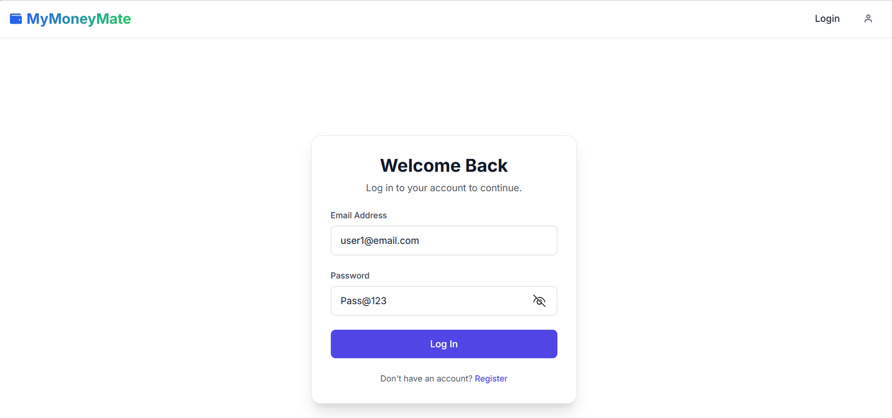
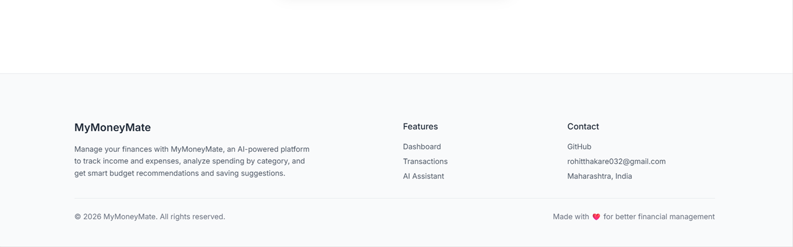

### Dashboard
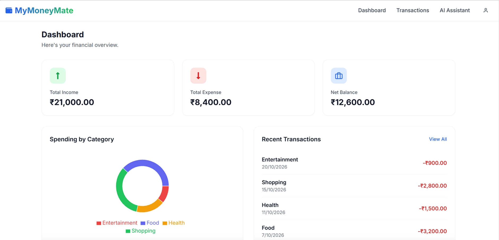
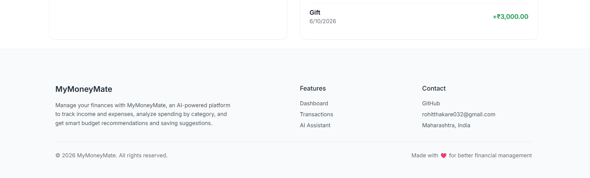

### Transactions
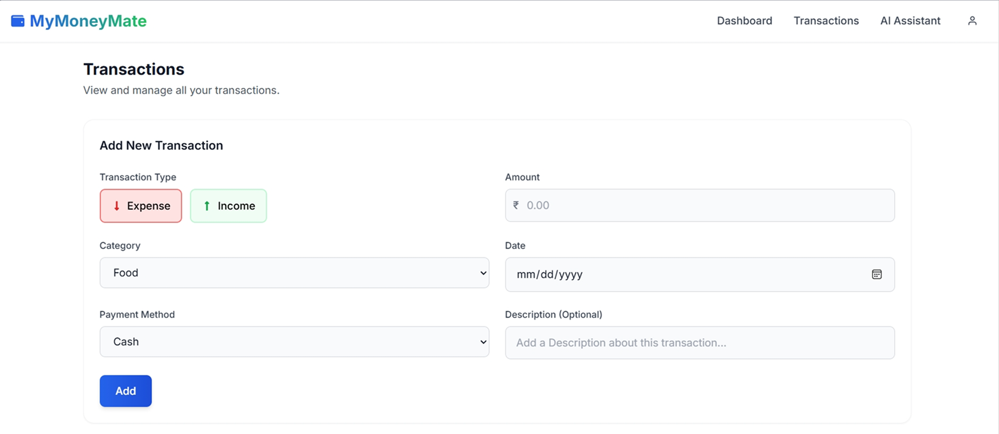
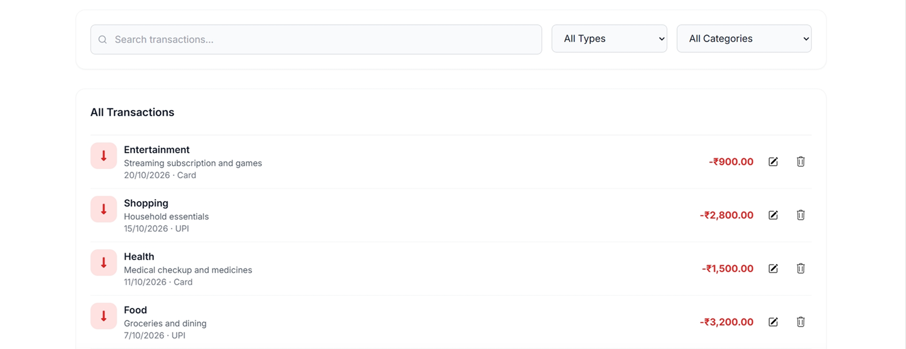
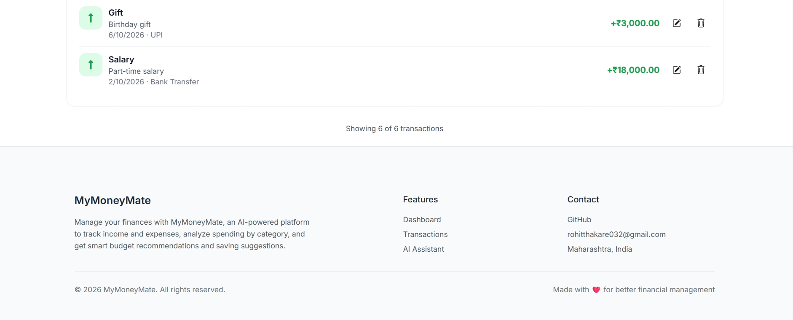

### AI Assistant
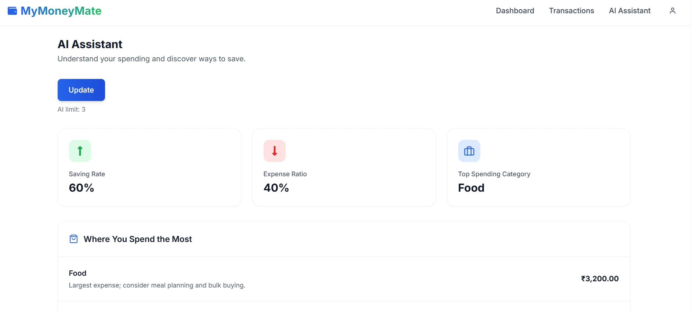
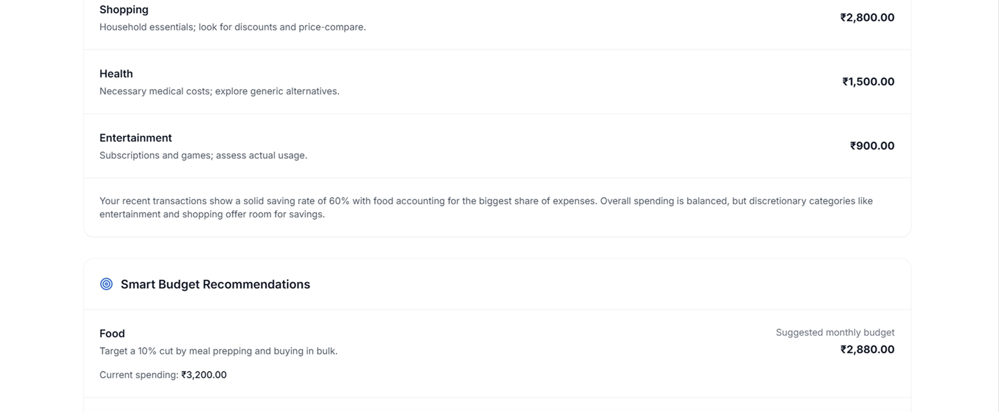
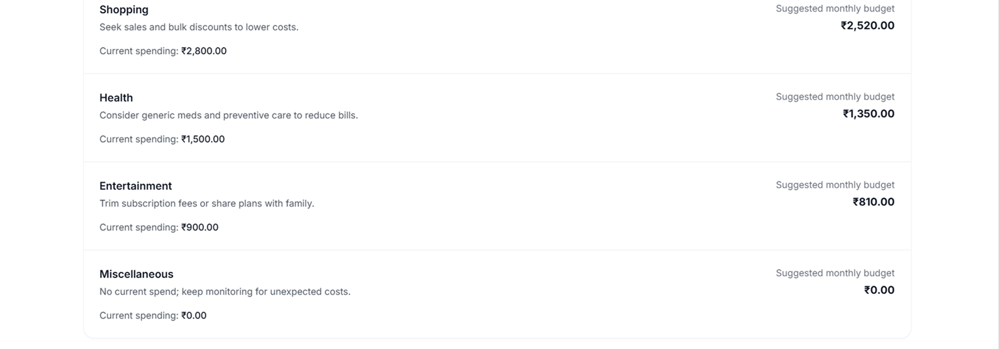
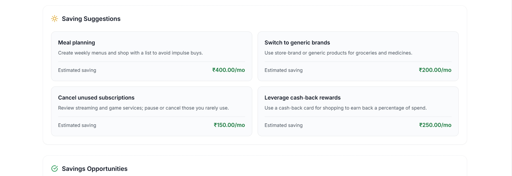
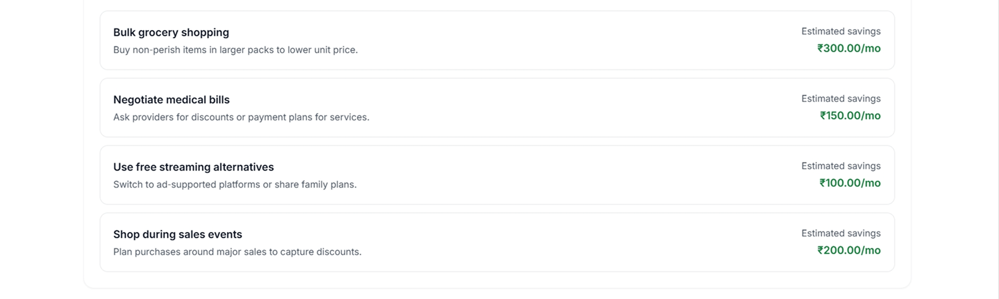


## Author

**Rohit Thakare**